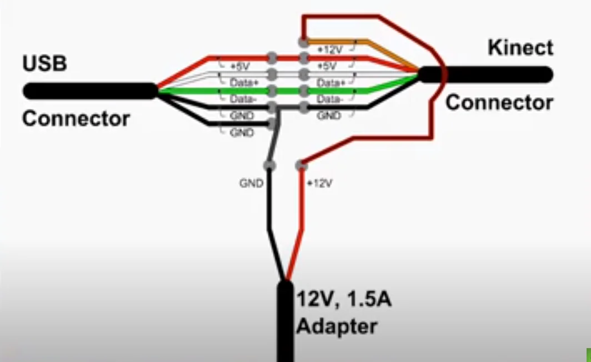

# Kinect Test

Bit pazarından aldığım Xbox 360 Kinect 1414 sensörünü tamir edip yeniden kullanmak için hazırladığım Python testleri. USB ve harici güç kablolamasını kendim yaptım; bu depoda RGB kamera, derinlik akışı ve motorlu eğim kontrolünü denediğim scriptler bulunuyor.

## Donanım ve bağlantı

- Xbox 360 Kinect 1414 (Kinect v1)
- Bilgisayara USB bağlantısı
- Harici 12 V DC güç kaynağı; aşağıdaki şemada 1,5 A adaptör gösteriliyor



Bağlantı düzeninde USB'nin veri hatları (D+ ve D−), 5 V hattı ve toprak bağlantısı Kinect tarafına taşınır. Kinect'in ayrı 12 V beslemesi harici adaptörden gelir; adaptörün eksi ucu USB/Kinect toprağıyla ortaktır.

**Bağlantı güvenliği:** 12 V hattını USB'nin 5 V veya veri hatlarına bağlamayın. Kablo renklerini tek başına pin tanımı olarak kullanmayın; cihaz modelini, pinleri, polariteyi ve kısa devre olmadığını enerjiyi vermeden önce multimetreyle doğrulayın. Ek yerlerini yalıtın; kablolama sırasında USB ve adaptör bağlı olmasın. Şema Kinect v1 içindir; Kinect v2 için kullanmayın.

## Yazılım gereksinimleri

- Python 3
- [libfreenect](https://github.com/OpenKinect/libfreenect) ve onun Python bağlayıcısı (`freenect`)
- OpenCV (`cv2`)
- NumPy
- OpenCV pencerelerini açabilen bir masaüstü oturumu

Dağıtımınıza uygun libfreenect, Python bağlayıcısı, OpenCV ve NumPy paketlerini kurun. Python bağlayıcısı için [libfreenect Python yönergelerine](https://github.com/OpenKinect/libfreenect/tree/master/wrappers/python) bakabilirsiniz. İşletim sistemi ayrıca Kinect'e USB erişim izni vermelidir.

Bağımlılıkları kontrol edin:

```bash
python3 -c "import freenect, cv2, numpy; print('Bağımlılıklar hazır')"
```

## Kullanım

```bash
git clone https://github.com/aToom13/Kinect_Test.git
cd Kinect_Test
```

Her seferinde tek bir test çalıştırın:

| Komut | İşlev |
|---|---|
| `python3 rgb_test.py` | RGB kamera görüntüsünü gösterir. |
| `python3 depth_test.py` | Ham derinlik akışını renkli olarak gösterir. |
| `python3 kinect_test.py` | RGB ve derinlik akışlarını birlikte gösterir; eğim motorunu kontrol eder. |

OpenCV görüntü penceresi odaktayken:

| Tuş | İşlev |
|---|---|
| `q` | Testten çıkış |
| `w` | Birleşik testte motor açısını 5 derece artırma |
| `s` | Birleşik testte motor açısını 5 derece azaltma |
| `x` | Birleşik testte motoru 0 dereceye getirme |

Birleşik test motor komutunu −30 ile +30 derece arasında sınırlar. Motoru hareket ettirirken sensörün çevresini boş bırakın.

## Sınırlar ve sorun giderme

Bu depo donanım denemelerinden oluşur; kalibre edilmiş bir mesafe ölçüm sistemi değildir. Derinlik görüntüsündeki renkler ve 8 bit değerler doğrudan metre cinsinden mesafe göstermez.

- `ModuleNotFoundError: freenect`: libfreenect'in Python bağlayıcısının kullandığınız Python ortamına kurulduğunu kontrol edin.
- Cihaz açılamıyorsa güç kaynağını, USB bağlantısını ve cihaz erişim izinlerini kontrol edin. Başka bir Kinect uygulamasını kapatın.
- Görüntü gelmiyorsa başka bir USB portu deneyin; aynı anda yalnızca tek test scripti çalıştırın.
- Pencere açılamıyorsa grafik oturumunu ve OpenCV'nin GUI desteğini kontrol edin; headless OpenCV paketi bu testler için yeterli değildir.
